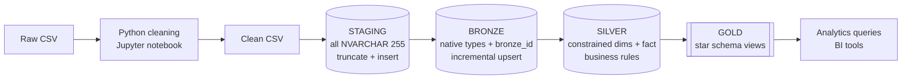
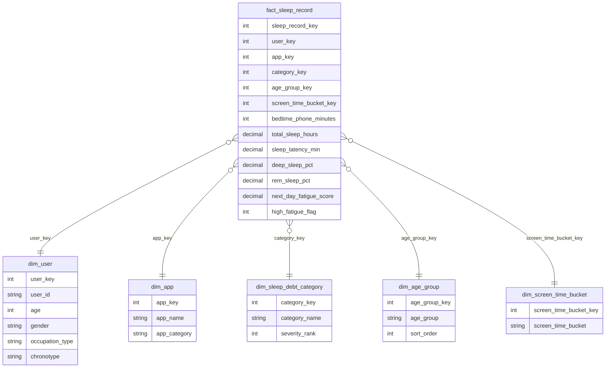

# Sleep Debt Medallion Data Warehouse

An end-to-end data engineering project that turns a raw CSV about **bedtime phone use, sleep quality and sleep debt** into an analytics-ready **star schema**. The data is cleaned in Python (Jupyter), then moved through a **Medallion Architecture** (Staging → Bronze → Silver → Gold) built in **SQL Server (T-SQL)**.

   

---

## Table of contents
1. [Project overview](#1-project-overview)
2. [Architecture](#2-architecture)
3. [Dataset](#3-dataset)
4. [Phase 1: Python data cleaning](#4-phase-1-python-data-cleaning)
5. [Phase 2: Warehouse layers](#5-phase-2-warehouse-layers)
6. [Gold star schema](#6-gold-star-schema)
7. [Business rules](#7-business-rules)
8. [Repository structure](#8-repository-structure)
9. [How to run](#9-how-to-run)
10. [Analytics queries](#10-analytics-queries)
11. [Design decisions and limitations](#11-design-decisions-and-limitations)
12. [Tech stack](#12-tech-stack)

---

## 1. Project overview

| | |
|---|---|
| **Goal** | Build a reliable, repeatable pipeline from a raw CSV to business-ready reporting views |
| **Source** | `bedtime_screentime_sleep_debt.csv` (8,500 users × 18 columns) |
| **Cleaning** | Python (pandas) in a Jupyter notebook |
| **Warehouse** | SQL Server, four schemas: `staging`, `bronze`, `silver`, `gold` |
| **Output** | Star schema views and 10 ready-to-run analytics queries |

**Business questions the warehouse answers**
- Does more phone time before bed mean less sleep and more fatigue?
- Does a blue light filter or late caffeine change how fast people fall asleep?
- Which bedtime apps, chronotypes, occupations and age groups are linked to the worst sleep debt?

---

## 2. Architecture



| Layer | Purpose | Key rules |
|---|---|---|
| **Staging** | Landing zone that mirrors the clean CSV | Every column is `NVARCHAR(255)` so no row can fail on load. `TRUNCATE` then `BULK INSERT` |
| **Bronze** | Typed copy of the data | Native data types, `bronze_id` tracking column, incremental upsert (**no truncate**), de-duplication keeping the highest `bronze_id` |
| **Silver** | Cleansed production tables | PK, FK, `NOT NULL`, `CHECK` and `UNIQUE` constraints, enrichment and business rules |
| **Gold** | Reporting layer | Views only, modeled as a star schema |

---

## 3. Dataset

**File:** `bedtime_screentime_sleep_debt.csv`, **8,500 rows**, one row per user (`user_id` is unique).

| Column | Type | Description |
|---|---|---|
| `user_id` | text | Unique user identifier (`USR-00001` format) |
| `age` | int | Age in years (18–65) |
| `gender` | text | Female, Male, Non-Binary |
| `occupation_type` | text | Corporate 9-to-5, Remote Tech, Student, Healthcare / Shift Worker, Freelance / Creative |
| `chronotype` | text | Morning Lark, Intermediate, Night Owl |
| `bedtime_phone_minutes` | int | Minutes of phone use at bedtime (1–180) |
| `primary_bedtime_app` | text | TikTok / Reels, YouTube, Instagram / Reddit, Streaming (Netflix/Hulu), Messaging / Chat, News / Reading |
| `screen_brightness_pct` | int | Screen brightness percentage (10–100) |
| `blue_light_filter_active` | 0/1 | Whether a blue light filter was on |
| `caffeine_post_5pm_mg` | int | Caffeine after 5 pm in mg (0–250) |
| `physical_activity_min` | int | Minutes of physical activity (0–112) |
| `sleep_latency_min` | decimal | Minutes taken to fall asleep |
| `total_sleep_hours` | decimal | Total sleep in hours (3.2–9.8) |
| `deep_sleep_pct` | decimal | Share of sleep that is deep sleep |
| `rem_sleep_pct` | decimal | Share of sleep that is REM |
| `morning_alarm_snoozes` | int | Number of alarm snoozes (0–7) |
| `next_day_fatigue_score` | decimal | Fatigue score from 1 to 10 |
| `sleep_debt_category` | text | Optimal Recovery, Mild Deficit, Moderate Debt, Severe Sleep Debt |

**Data profile findings**
- No missing values, no duplicate rows, no whitespace or casing problems in the raw file.
- `sleep_debt_category` is **not** a simple function of `total_sleep_hours`: the hour ranges of the categories overlap (for example Moderate Debt spans 3.20–6.74 h and Severe spans 3.20–5.38 h). It is therefore treated as a source attribute and is not recomputed.
- 314 users sit exactly at the maximum fatigue score of 10, so the score appears capped. The values are kept as they are.

---

## 4. Phase 1: Python data cleaning

**Notebook:** [`python_cleaning/clean_sleep_data.ipynb`](python_cleaning/clean_sleep_data.ipynb)

| Step | What it does |
|---|---|
| 1. Load | Reads the raw CSV with pandas |
| 2. Inspect | `info()`, null counts, duplicate count, `describe()` |
| 3. Column names | Lowercase `snake_case`, special characters removed |
| 4. Text | Trims spaces, unifies case variants (`female` → `Female`), upper-cases `user_id` |
| 5. Types | Numbers via `to_numeric`, boolean column mapped to 0/1 |
| 6. Missing values | Drops rows with no `user_id`; median for numbers, `Unknown` for text |
| 7. Duplicates | Removes identical rows and repeated `user_id` values |
| 8. Validation | Drops impossible values (for example sleep over 24 h, deep + REM over 100%) |
| 9. Save | Writes the clean CSV (`\n` line endings, ready for `BULK INSERT`) |
| 10. Quality log | Saves a small summary table of rows in/out and what was removed |

**Result on this dataset:** 8,500 rows in, 8,500 rows out. The raw file was already clean, so no row was removed or changed. The notebook was also tested on a deliberately messy copy (bad headers, stray spaces, a duplicate, a null, an impossible value) and fixed all of them.

---

## 5. Phase 2: Warehouse layers

### `00_init_database.sql`
Drops and re-creates the `SleepDebtDW` database, then creates the schemas `staging`, `bronze`, `silver` and `gold`.

> **Warning:** this script deletes an existing `SleepDebtDW` database.

### Staging (`01_staging/`)
- `staging.sleep_debt_raw`: 18 columns, all `NVARCHAR(255)`.
- `staging.load_staging @file_path`: truncates the table and loads the CSV with `BULK INSERT` (`FORMAT = 'CSV'`, UTF-8). Prints the row count and duration, with `TRY/CATCH` error handling.

### Bronze (`02_bronze/`)
- `bronze.sleep_debt_raw`: native types (`INT`, `DECIMAL`, `BIT`, `NVARCHAR`), `bronze_id IDENTITY` as primary key, `bronze_loaded_at` and `bronze_updated_at` tracking columns.
- `bronze.load_bronze` (incremental, no truncate):
  1. Converts staging values with `TRY_CAST` (a bad value becomes `NULL` instead of failing the load).
  2. De-duplicates the incoming batch on `user_id`.
  3. Updates existing users only when something actually changed (NULL-safe comparison with `EXCEPT`).
  4. Inserts users that are new.
  5. Removes any older duplicates, keeping the row with the **highest `bronze_id`**.
  - Running it twice on the same data changes nothing (idempotent).

### Silver (`03_silver/`)
- `silver.dim_user`, `silver.dim_app`, `silver.dim_sleep_debt_category` and `silver.fact_sleep_record`, with surrogate keys, primary and foreign keys, `NOT NULL`, `UNIQUE` and `CHECK` constraints.
- `silver.load_silver`: takes the latest Bronze row per user, trims text, validates mandatory fields and ranges, upserts the dimensions, rebuilds the fact, and reports how many rows were rejected. Runs inside a transaction.

### Gold (`04_gold/`)
`CREATE VIEW` statements only. See the next section.

---

## 6. Gold star schema



**Grain:** one row per user. The source has no date column, so there is no date dimension.

---

## 7. Business rules

Applied in `silver.load_silver`.

| Rule | Logic |
|---|---|
| `age_group` | 18-24, 25-34, 35-44, 45-54, 55+ |
| `screen_time_bucket` | Low (<30 min), Moderate (30-59), High (60-119), Very High (120+) |
| `has_caffeine_flag` | 1 when `caffeine_post_5pm_mg` > 0 |
| `deep_rem_total_pct` | `deep_sleep_pct + rem_sleep_pct` |
| `high_fatigue_flag` | 1 when `next_day_fatigue_score` >= 7 |
| `app_category` | Social Media (TikTok, Instagram), Video & Streaming (YouTube, Netflix/Hulu), Communication, News & Reading |
| `severity_rank` | 1 Optimal Recovery, 2 Mild Deficit, 3 Moderate Debt, 4 Severe Sleep Debt |
| Rejection | Rows with a missing mandatory field or out-of-range value are counted and not loaded |

---

## 8. Repository structure

```
sleep-debt-medallion-data-warehouse/
├── 00_init_database.sql          # database + schemas
├── 01_staging/
│   ├── 01_ddl_staging.sql
│   └── 02_sp_load_staging.sql
├── 02_bronze/
│   ├── 01_ddl_bronze.sql
│   └── 02_sp_load_bronze.sql
├── 03_silver/
│   ├── 01_ddl_silver.sql
│   └── 02_sp_load_silver.sql
├── 04_gold/
│   └── 04_gold_views.sql
├── 05_analytics_queries.sql      # business analysis
├── python_cleaning/
│   └── clean_sleep_data.ipynb    # Phase 1 cleaning notebook
├── data/
│   ├── bedtime_screentime_sleep_debt.csv         # raw
│   ├── bedtime_screentime_sleep_debt_clean.csv   # cleaned (staging input)
│   └── bedtime_screentime_sleep_debt_quality_log.csv
└── README.md
```

---

## 9. How to run

### Requirements
- Python 3 with `pandas` and Jupyter
- SQL Server 2017 or later (needed for `BULK INSERT ... FORMAT = 'CSV'`) and SSMS or Azure Data Studio

### Steps

**1. Clean the data**
Open `python_cleaning/clean_sleep_data.ipynb` in Jupyter and run all cells. This writes `data/bedtime_screentime_sleep_debt_clean.csv`.

**2. Build the database and tables** (run each file in this order)

| Order | File |
|---|---|
| 1 | `00_init_database.sql` |
| 2 | `01_staging/01_ddl_staging.sql` then `02_sp_load_staging.sql` |
| 3 | `02_bronze/01_ddl_bronze.sql` then `02_sp_load_bronze.sql` |
| 4 | `03_silver/01_ddl_silver.sql` then `02_sp_load_silver.sql` |
| 5 | `04_gold/04_gold_views.sql` |

**3. Load the data**

```sql
USE SleepDebtDW;

EXEC staging.load_staging @file_path = N'C:\SleepDebtDW\data\bedtime_screentime_sleep_debt_clean.csv';
EXEC bronze.load_bronze;
EXEC silver.load_silver;
```

> The file path is read by the SQL Server **service**, not by your PC. Copy the clean CSV to a folder the server can access, and change the path above to match.

**4. Analyze**
Run `05_analytics_queries.sql`.

**Sanity check after loading**

```sql
SELECT 'staging' AS layer, COUNT(*) AS rows FROM staging.sleep_debt_raw
UNION ALL SELECT 'bronze', COUNT(*) FROM bronze.sleep_debt_raw
UNION ALL SELECT 'silver', COUNT(*) FROM silver.fact_sleep_record
UNION ALL SELECT 'gold',   COUNT(*) FROM gold.fact_sleep_record;
```

All four counts should be 8,500 for the provided dataset.

---

## 10. Analytics queries

`05_analytics_queries.sql` contains ten queries on the Gold views.

| # | Question |
|---|---|
| Q1 | Overall KPIs (users, average sleep, phone time, latency, fatigue) |
| Q2 | Distribution of sleep debt categories |
| Q3 | Sleep, latency, deep sleep and fatigue by bedtime screen-time bucket |
| Q4 | Share of users in moderate or severe debt by screen-time bucket |
| Q5 | Blue light filter on vs. off |
| Q6 | Bedtime apps linked to the least sleep |
| Q7 | Chronotype × occupation: who sleeps least |
| Q8 | Impact of caffeine after 5 pm |
| Q9 | Age group profile |
| Q10 | Physical activity quartiles vs. sleep |

---

## 11. Design decisions and limitations

- **One fact table at user grain.** The source has one row per user and no dates, so there is no time dimension and no trend analysis.
- **Bronze upserts in place.** Changed users are updated and new users are inserted, with cleanup keeping the highest `bronze_id`. It does not keep a history of changes. If history is needed, switch to an insert-only version pattern.
- **Silver fact is rebuilt on every run**, while dimension surrogate keys stay stable.
- **Rejected rows are not stored.** Silver reports how many were rejected but does not keep them in a quarantine table. A reject table would be a good next step.
- **Correlation, not causation.** The analytics show associations in the dataset only.
- **SQL Server only.** The T-SQL uses `TRY_CAST`, `CREATE OR ALTER`, `BULK INSERT` and `THROW`, so it will not run unchanged on other engines.

**Possible improvements:** a reject/quarantine table, load logging table, SQL Agent job to schedule the loads, unit tests for the procedures, and a Power BI or Tableau dashboard on the Gold views.

---

## 12. Tech stack

Python · pandas · Jupyter Notebook · SQL Server · T-SQL · Medallion Architecture · Star Schema · Mermaid (diagrams)

---

## Author

**Mariam Isaac** · Data analytics
