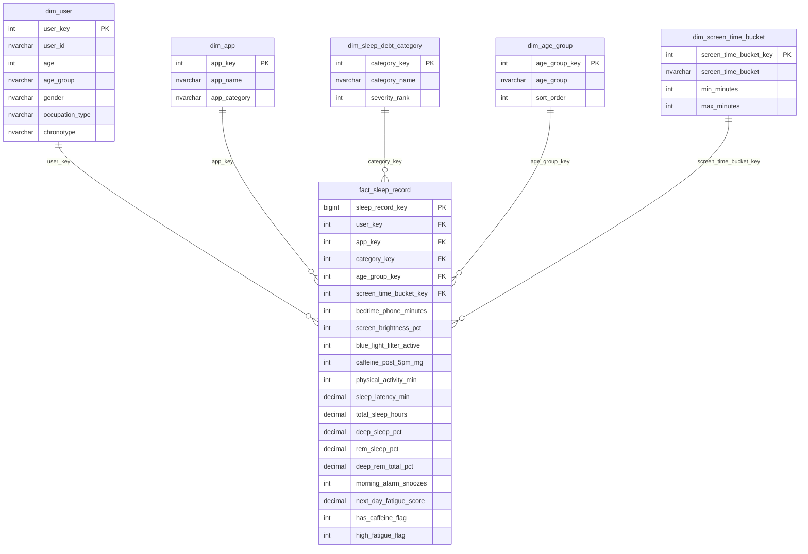

# SleepDebtDW - Power BI & Tableau Implementation Guide

This guide describes how to connect **Power BI** or **Tableau** directly to the `SleepDebtDW` SQL Server Data Warehouse (Gold Layer) to build an enterprise-grade reporting dashboard.

---

## 1. Data Warehouse Architecture & Star Schema

The Gold Layer exposes star schema views optimized for BI tools:



---

## 2. Power BI Setup & DAX Measures

### A. Connecting to SQL Server
1. Open Power BI Desktop.
2. Select **Get Data** -> **SQL Server Database**.
3. Enter Server Name (e.g. `localhost` or your SQL instance) and Database: `SleepDebtDW`.
4. Choose **Import** (recommended for sub-10k user records) or **DirectQuery**.
5. Select the 6 views in the `gold` schema:
   - `gold.fact_sleep_record`
   - `gold.dim_user`
   - `gold.dim_app`
   - `gold.dim_sleep_debt_category`
   - `gold.dim_age_group`
   - `gold.dim_screen_time_bucket`

### B. Modeling Relationships
Ensure the relationships match the diagram above (1-to-many from dimensions to fact, Single filter direction).
- In `dim_age_group`, set **Sort by Column** = `sort_order`.
- In `dim_sleep_debt_category`, set **Sort by Column** = `severity_rank`.
- In `dim_screen_time_bucket`, set **Sort by Column** = `min_minutes`.

### C. Standard DAX Measures

```dax
// 1. Cohort Volume
Total Users = COUNTROWS(fact_sleep_record)

// 2. Average Total Sleep Hours
Avg Sleep Hours = 
ROUND(AVERAGE(fact_sleep_record[total_sleep_hours]), 2)

// 3. Average Bedtime Phone Screen Time (Minutes)
Avg Bedtime Screen Min = 
ROUND(AVERAGE(fact_sleep_record[bedtime_phone_minutes]), 1)

// 4. Average Sleep Onset Latency (Minutes)
Avg Sleep Latency Min = 
ROUND(AVERAGE(fact_sleep_record[sleep_latency_min]), 1)

// 5. Average Next-Day Fatigue Score
Avg Fatigue Score = 
ROUND(AVERAGE(fact_sleep_record[next_day_fatigue_score]), 2)

// 6. High Fatigue Rate (%) [Fatigue Score >= 7]
Pct High Fatigue = 
DIVIDE(
    CALCULATE(COUNTROWS(fact_sleep_record), fact_sleep_record[high_fatigue_flag] = 1),
    COUNTROWS(fact_sleep_record),
    0
) * 100

// 7. Moderate or Severe Sleep Debt Rate (%)
Pct Moderate or Severe Debt = 
DIVIDE(
    CALCULATE(COUNTROWS(fact_sleep_record), dim_sleep_debt_category[severity_rank] >= 3),
    COUNTROWS(fact_sleep_record),
    0
) * 100

// 8. Deep Sleep Percentage
Avg Deep Sleep Pct = 
ROUND(AVERAGE(fact_sleep_record[deep_sleep_pct]), 1)

// 9. Average Alarm Snoozes
Avg Alarm Snoozes = 
ROUND(AVERAGE(fact_sleep_record[morning_alarm_snoozes]), 2)
```

---

## 3. Tableau Setup & Calculated Fields

### A. Data Source Canvas
- Connect to Microsoft SQL Server `SleepDebtDW`.
- Drag `gold.fact_sleep_record` to the canvas.
- Join dimensions using inner/left joins on the surrogate keys (`user_key`, `app_key`, `category_key`, `age_group_key`, `screen_time_bucket_key`).

### B. Tableau Calculated Fields

- **High Fatigue User Count**:
  ```tableau
  IF [High Fatigue Flag] = 1 THEN 1 ELSE 0 END
  ```
- **Severe Sleep Debt Flag**:
  ```tableau
  IF [Severity Rank] >= 3 THEN 1 ELSE 0 END
  ```
- **Sleep Deficit vs 7h Recommendation**:
  ```tableau
  [Total Sleep Hours] - 7.0
  ```

---

## 4. Visual Dashboard Layout & Wireframe

| Position | Visual Component | Chart Type | Data Source / Fields |
|---|---|---|---|
| **Top Banner** | Executive KPIs (6 Cards) | Multi-row Cards | Total Users, Avg Sleep Hours, Avg Phone Min, Avg Latency, Avg Fatigue, Severe Debt % |
| **Row 2 Left** | Screen Time vs Sleep & Latency | Dual-Axis Combo | X: `screen_time_bucket`, Bar: `Avg Sleep Hours`, Line: `Avg Sleep Latency Min` |
| **Row 2 Right**| Sleep Debt Classification | Doughnut Chart | Dimension: `category_name`, Measure: `Total Users`, Color by `severity_rank` |
| **Row 3 Left** | Bedtime Apps Disruption Ranking | Horizontal Bar | Y: `app_name`, X: `Avg Sleep Hours`, Tooltip/Color: `app_category` & `Avg Fatigue` |
| **Row 3 Right**| Chronotype vs Occupation Matrix | Clustered Bar / Heatmap | Rows: `occupation_type`, Columns: `chronotype`, Value: `Avg Sleep Hours` |
| **Row 4 Left** | Interventions Efficacy | Grouped Bar | Groups: Blue Light Filter (0/1), Late Caffeine (0/1), Values: Latency & Deep Sleep % |
| **Row 4 Right**| Age Group Profile | Line & Column | X: `age_group`, Bar: `Avg Bedtime Screen Min`, Line: `Pct High Fatigue` |
| **Bottom** | User Record Drill-through Table | Matrix / Table | User ID, Age, Chronotype, Occupation, App, Phone Min, Latency, Hours, Debt Category |

---

## 5. Design & Color Palette

- **Optimal Recovery**: `#10B981` (Emerald Green)
- **Mild Deficit**: `#3B82F6` (Sky Blue)
- **Moderate Debt**: `#F59E0B` (Amber Orange)
- **Severe Sleep Debt**: `#EF4444` (Rose Red)
- **Accent Indigo**: `#6366F1`
- **Background / Surfaces**: Dark Theme `#0B0F19` / Card `#111827` or Clean Light `#F8FAFC` / Card `#FFFFFF`.
